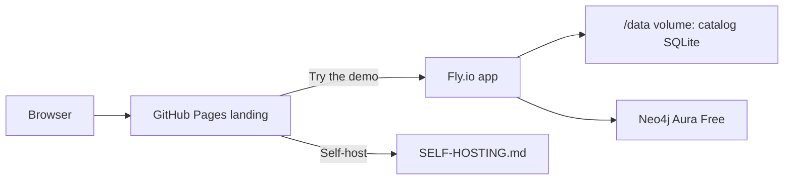

# Public demo hosting (Fly.io + Neo4j Aura Free)

This is how the **hosted demo** at [https://pona-flow.fly.dev](https://pona-flow.fly.dev)
is run. Visitors sign up in the browser (open sign-up) and can create spaces. Self-hosting
remains the durable install path — see [SELF-HOSTING.md](SELF-HOSTING.md).



## Prerequisites

| Tool | Notes |
|------|--------|
| [Fly.io](https://fly.io) account | Free allowance is enough for a small shared-cpu demo |
| [`flyctl`](https://fly.io/docs/hands-on/install-flyctl/) | `brew install flyctl` or the install script |
| [Neo4j Aura Free](https://neo4j.com/cloud/aura-free/) | Create one free instance; copy the `neo4j+s://` URI, user, password |

Docker Desktop is **not** required on your laptop: `fly deploy` builds remotely.

## One-time setup

### 1. Neo4j Aura Free

1. Create an Aura Free instance (any region close to `iad` is fine).
2. Download / copy credentials. You need:
   - `NEO4J_URI` — looks like `neo4j+s://xxxxxxxx.databases.neo4j.io`
   - `NEO4J_USER` — usually `neo4j`
   - `NEO4J_PASSWORD` — the generated password (shown once)

### 2. Fly app + volume

```bash
cd pona-flow
fly auth login
fly apps create pona-flow          # skip if the name is taken; edit fly.toml app =
fly volumes create pona_data --region iad --size 1
```

### 3. Secrets

```bash
fly secrets set \
  NEO4J_URI='neo4j+s://YOUR.databases.neo4j.io' \
  NEO4J_USER='neo4j' \
  NEO4J_PASSWORD='YOUR_AURA_PASSWORD'
```

Optional: bump `PONA_FLOW_PUBLIC_URL` in [`fly.toml`](../fly.toml) if the app name differs.

### 4. Deploy

```bash
fly deploy
fly status
curl -fsS https://pona-flow.fly.dev/healthz?deep=1
```

Expect `"status":"ok"` with both `catalog` and `neo4j` checks passing.

### 5. Create the operator admin (once)

The first account on an empty instance is the **instance admin**. Do this yourself before
pointing the public at the URL, otherwise a random visitor becomes admin:

```bash
curl -fsS -X POST https://pona-flow.fly.dev/api/auth/setup \
  -H 'Content-Type: application/json' \
  -H 'Origin: https://pona-flow.fly.dev' \
  -d '{"email":"YOU@example.com","password":"choose-a-strong-password","display_name":"Operator"}'
```

Store that password. Later visitors use **Create an account** (open sign-up); they get
`can_create_spaces` via `PONA_FLOW_SIGNUP_CAN_CREATE_SPACES=1` in `fly.toml`.

## Day-2

```bash
fly deploy                  # after merging to main
fly logs
fly ssh console -C 'python tools/reset_password.py you@example.com'
```

Catalog state lives on the `pona_data` volume; Neo4j data lives in Aura. Back up both if
the demo ever holds data you care about ([OPERATOR-BACKUP.md](OPERATOR-BACKUP.md)).

## First-time user walkthrough (what to click)

1. Open [https://mitchmcquinn.github.io/pona-flow/](https://mitchmcquinn.github.io/pona-flow/)
2. **Try the demo** → https://pona-flow.fly.dev
3. **Create an account** (any email; demo has open sign-up)
4. Create a space when prompted
5. Explore the dashboard; optionally open **Agents** for the MCP URL
6. (Optional) **Self-host** from the landing secondary CTA → [SELF-HOSTING.md](SELF-HOSTING.md)

## Demo policy (keep it honest)

- This is a **shared sandbox**. Expect data to be wiped without notice.
- Do not put secrets or real customer data on the demo.
- Open sign-up + space creation are intentional for the walkthrough; tighten both before
  treating the instance as production.
