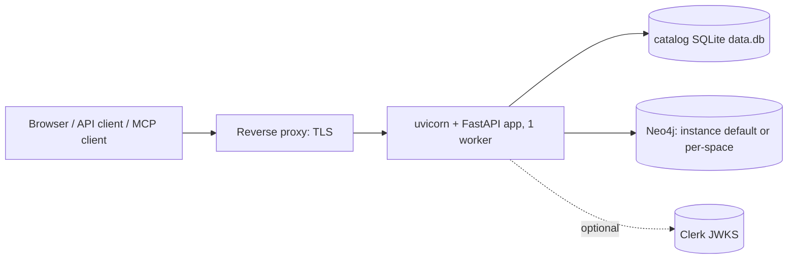

# Deployment & Operations

Operator reference for a self-hosted pona flow instance. If you just want it running,
start with [SELF-HOSTING.md](SELF-HOSTING.md) (Docker Compose quickstart); this document
is the detail behind it. Backup and restore: [OPERATOR-BACKUP.md](OPERATOR-BACKUP.md).
Local developer machine: [FIRST-TIME-SETUP.md](FIRST-TIME-SETUP.md). End users:
[GETTING-STARTED.md](GETTING-STARTED.md).



An instance is **single-tenant**: one process, one catalog, one or more Neo4j databases, a
set of accounts. Run one instance per organisation.

---

## 1. Runtime

### Container (recommended)

`ghcr.io/mitchmcquinn/pona-flow:<version>` contains the engine and the built UI. It runs
as a non-root user, writes only to `/data`, exposes `8765`, and has a `HEALTHCHECK` on
`/healthz`. `docker-compose.yml` at the repo root wires it to a bundled Neo4j and an
optional Caddy; see [SELF-HOSTING.md](SELF-HOSTING.md).

### Bare process

```bash
python3 -m venv .venv && .venv/bin/pip install -r requirements.txt
(cd App/ui && npm ci && npm run build)          # the app serves App/ui/dist
PONA_FLOW_DATA_DIR=/var/lib/pona-flow \
.venv/bin/uvicorn server.app:app --host 127.0.0.1 --port 8765 --app-dir Engine --proxy-headers
```

Run it under systemd or another supervisor. **One worker only.** The event scheduler
(timers, waits, embedding sweeps) and the MCP session manager run in-process; a second
worker would double-fire timers. Scale vertically or run separate instances.

### Data directory

`PONA_FLOW_DATA_DIR` (default: repository root; `/data` in the image) holds:

| File | Contents |
|------|----------|
| `data.db` | Catalog: spaces, members, saved operations, run `state`, events, audit log, accounts, sessions |
| `<space>.db` etc. | Per-space SQLite files when a space names one (relative paths resolve here) |
| `.env` | Values written by the `local` credential backend (Credentials tab) |

Back up the whole directory together with Neo4j ([OPERATOR-BACKUP.md](OPERATOR-BACKUP.md)).

### Health

`GET /healthz` (no auth) returns `200 {"status":"ok"}` when the process is up and the
catalog opens; `503` otherwise. `GET /healthz?deep=1` also verifies the instance Neo4j
connection. Bodies never include connection strings.

---

## 2. Edge: reverse proxy

The application does not terminate TLS. Put any HTTPS-terminating proxy in front and
forward to `127.0.0.1:8765`. Requirements:

- Forward `X-Forwarded-Proto` (the compose `https` profile and most proxies do). The app
  uses it to mark session cookies `Secure` and to send HSTS.
- Set `PONA_FLOW_PUBLIC_URL=https://your.host` so cookies are `Secure` even if a header is
  missing and so the MCP gateway accepts that `Host`.
- Do not expose `:8765` directly on a public interface.

The app sets `X-Content-Type-Options`, `X-Frame-Options: DENY`, `Referrer-Policy`,
`Permissions-Policy`, and HSTS (on HTTPS) itself. CORS is not set: the UI is same-origin.
Add a Content-Security-Policy, WAF rules, or rate limiting at the proxy if you want them;
the app already throttles login attempts (8 per email, 20 per IP, per 15 minutes).

---

## 3. Authentication

`PONA_FLOW_AUTH_MODE` selects the provider. Both produce the same `users` rows, so RBAC,
invites, and agent keys are identical either way.

### `local` (default): built-in accounts

- Passwords are hashed with scrypt; sessions are random tokens stored hashed, delivered as
  an `HttpOnly`, `SameSite=Lax` cookie (`Secure` on HTTPS). Lifetime
  `PONA_FLOW_SESSION_DAYS` (30).
- **Bootstrap:** an instance with no accounts serves a setup page; the account created
  there is the instance admin. The endpoint closes permanently after the first account.
- **Sign-up** is allowed only for an email that holds a pending space invite (Users
  panel), or for anyone when `PONA_FLOW_ALLOW_OPEN_SIGNUP=1`.
- Unsafe requests (POST/PUT/DELETE) carrying the cookie must be same-origin
  (`Sec-Fetch-Site` / `Origin`), which blocks CSRF. API clients use a `Bearer pfs_...`
  session token or an agent key instead.
- Password reset: `python tools/reset_password.py <email>` (prompts; revokes that user's
  sessions). In Docker: `docker compose exec pona-flow python tools/reset_password.py ...`.

### `clerk`: hosted identity provider

Set `PONA_FLOW_AUTH_MODE=clerk` and:

| Variable | Purpose |
|----------|---------|
| `CLERK_ISSUER` | Clerk Frontend API URL; JWKS URL is derived from it |
| `CLERK_PUBLISHABLE_KEY` | Served to the browser by `/api/auth/status` (no UI rebuild needed) |
| `CLERK_JWKS_URL`, `CLERK_AUTHORIZED_PARTIES`, `CLERK_JWT_LEEWAY_SECONDS` | Optional tuning |
| `CLERK_SECRET_KEY` | Lets the server resolve member emails/names from Clerk; required for the Cypress suite |

The first person to sign in on an empty instance becomes the instance admin.
`SUPERADMIN_EMAIL` / `SUPERADMIN_CLERK_ID` force the flag for a specific identity in
either mode.

### Development bypasses

`PONA_FLOW_DISABLE_AUTH=1` (synthetic admin on every request) and `DEV_DB_EDITOR_TOKEN`
(raw catalog editor) are refused at startup unless the server is bound to loopback, so
they cannot be left on in a container by accident.

---

## 4. Secrets & data

- Neo4j and SQLite connection values are referenced indirectly: `spaces` rows store the
  **names** of environment variables, never the secrets. The instance-wide `NEO4J_URI`,
  `NEO4J_USER`, `NEO4J_PASSWORD` are the defaults every space inherits; set
  `<SPACE>_NEO4J_URI` etc. to point one space at its own database.
- **User-managed credentials** (Credentials tab) follow the same indirection: the catalog
  `space_credentials` table stores only metadata; the value backend is selected by
  `PONA_FLOW_CREDENTIAL_BACKEND`:
  - `local` (image default): values entered in the UI are written to `<data dir>/.env`,
    which lives in the data volume. Convenient for a single-host install.
  - `passthrough`: read-only `os.environ`; register the slot in the UI and inject the
    value through your platform's secret store under the key shown
    (`<SPACE_ID>_CRED_<NAME>`). Preferred when you have a secret manager.
  Workflows reference a credential as `$secret.<NAME>`, resolved at request time and
  never persisted in the catalog or logged.
- Error responses are generic by default; exception detail goes to the server log.
  `PONA_FLOW_DEBUG_ERRORS=1` echoes it to the client (local development only).
- Never commit a production `.env`. [.env.example](../.env.example) lists every variable;
  [.env.docker.example](../.env.docker.example) is the short compose version.

---

## 5. Migrations

Catalog schema is applied deterministically at startup by
[`Engine/server/migrations.py`](../Engine/server/migrations.py) (idempotent
`CREATE ... IF NOT EXISTS` plus column backfills). No manual migration step is needed on
upgrade; per-space `entities` tables migrate on first space access. Upgrading the image
and restarting is the whole procedure.

---

## 6. Sequence endpoint-step safety (SSRF)

Sequence "endpoint" steps make outbound HTTP calls. By default the server blocks
private/loopback/link-local/reserved targets.

- `PONA_FLOW_OUTBOUND_ALLOWLIST`: comma-separated host allowlist. Hosts on it may be
  private or loopback, so a self-hosted
  [local-llm-server](https://github.com/MitchMcQuinn/local-llm-server) is reachable as
  `PONA_FLOW_OUTBOUND_ALLOWLIST=127.0.0.1`. Do not allowlist Ollama (`:11434`); the
  engine reaches it only through the embeddings module. Cloud embeddings are a
  separate setting (`PONA_FLOW_EMBED_PROVIDER=gemini`): the engine calls that https
  host itself and does not use this allowlist.
- `PONA_FLOW_ALLOW_PRIVATE_OUTBOUND=1` opens every private/loopback target. Only on a
  trusted network; prefer the allowlist.

Inside Docker, "the host machine" is `host.docker.internal`, not `127.0.0.1`.

---

## 7. MCP gateway Host validation

The per-space MCP endpoint validates the `Host` header against
`PONA_FLOW_MCP_ALLOWED_HOSTS`, or, when that is unset, against the hostname in
`PONA_FLOW_PUBLIC_URL` plus loopback. With neither set the check is off, which is only
appropriate behind a proxy that validates `Host` itself. Agent keys are the real
authorisation in every case ([MCP-GATEWAY.md](MCP-GATEWAY.md)).

---

## 8. Admin surface

`/api/db/*` (the raw catalog table editor and `App/data-db-editor.html`) is restricted to
**instance admins**. The editor page is a development tool and is not included in the
container image.

---

## 9. Provisioning checklist

1. Host with Docker; DNS name if it will be reached remotely.
2. `cp .env.docker.example .env`; set `NEO4J_PASSWORD`, and `PONA_FLOW_PUBLIC_URL` /
   `PONA_FLOW_DOMAIN` for a public install.
3. `docker compose up -d`; confirm `curl -s localhost:8765/healthz?deep=1` is `200`.
4. Open the URL; the setup page creates the instance admin. Store that password somewhere
   safe; `tools/reset_password.py` is the recovery path.
5. Admin creates spaces (creator becomes space owner) and invites members from the Users
   panel; invitees sign up with the invited email.
6. Mint agent keys per space (Agents panel) for MCP clients and webhooks.
7. Take a backup and **restore it once** on purpose ([OPERATOR-BACKUP.md](OPERATOR-BACKUP.md))
   before any data is treated as irreplaceable.
