# Visuals

One idea per frame. The first set is the Monday in the technical pitch: the words on the pictures match the narration in [video/TECHNICAL-PITCH.md](video/TECHNICAL-PITCH.md). The precise product terms follow, for readers who want them. The agency cut, which does not use these frames, is [video/AGENCY-PITCH.md](video/AGENCY-PITCH.md).

The narrative version is [PITCH.md](PITCH.md).

## Six rooms, then one

A wiki, a spreadsheet, an automation, a search box, a chat thread, and a prompt each hold one piece of the morning. Meaning, records, and work share one room.

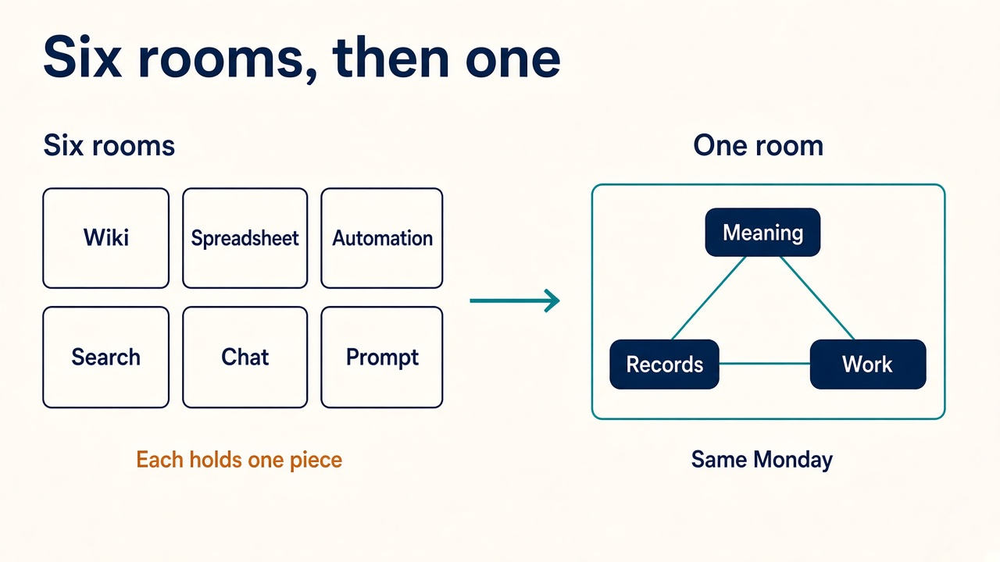

## Schema

Rules live on the type. A contractor is both a person and a vendor. High-value requires legal review. Change the rule once, and every record of that type follows.

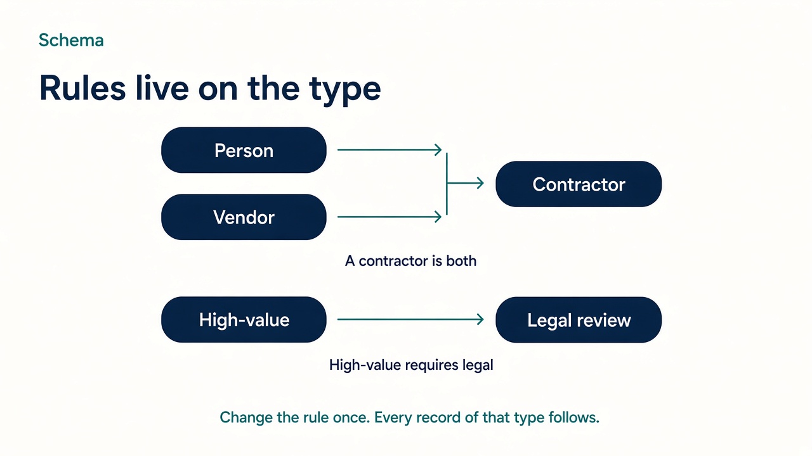

## Instance

Records point at records. This person bills through this company, and this company holds this agreement.

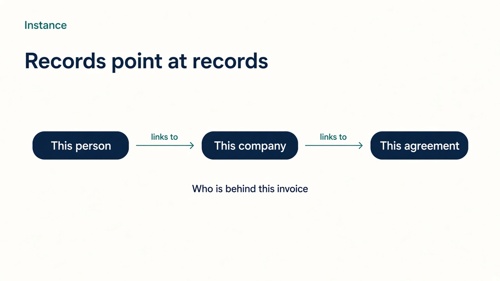

## Step

The checklist is the route. Find the person, check the rule, call screening, ask legal, wait for the form. A sequence names the first step.

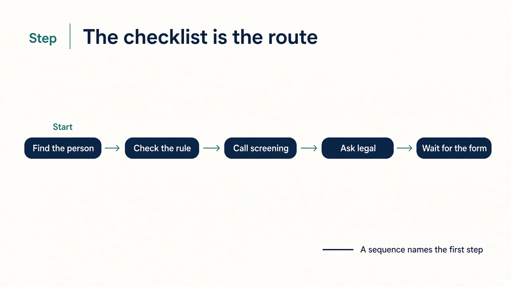

## Three lanes

Rules link to rules. Records link to records. Steps link to steps. A lane links only to itself.

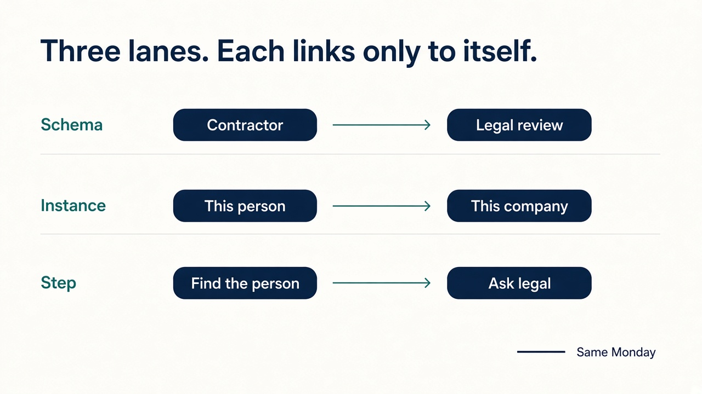

## The walk

A branch is a choice the checklist already understands: high-value asks legal, otherwise continue. A pause is a missing fact. The run stops as pending, hands back a state id, and resumes as the same run.

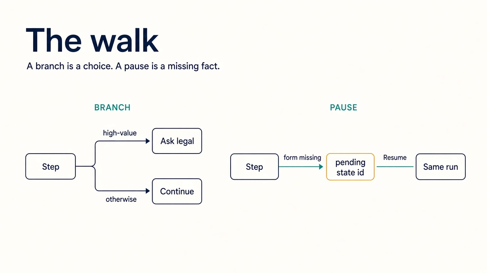

## One checklist, three doors

The dashboard, a webhook, and a chat tool open the same checklist. If the form is missing, every door hears the same pause.

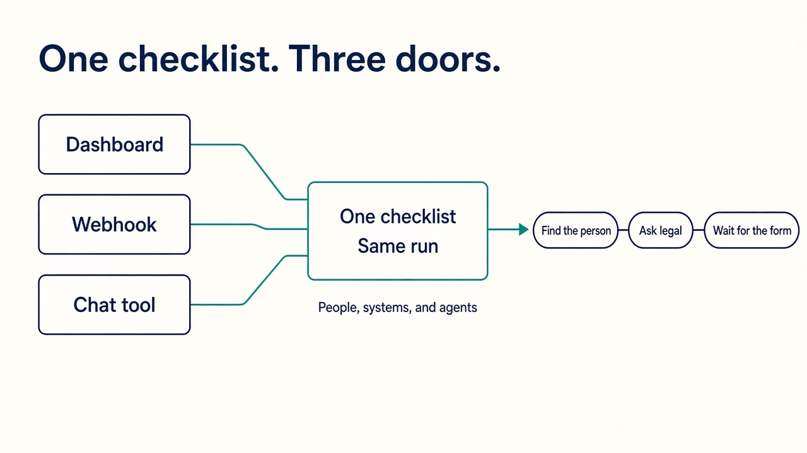

## The trace

We asked legal because this agreement is high-value, and high-value requires legal.

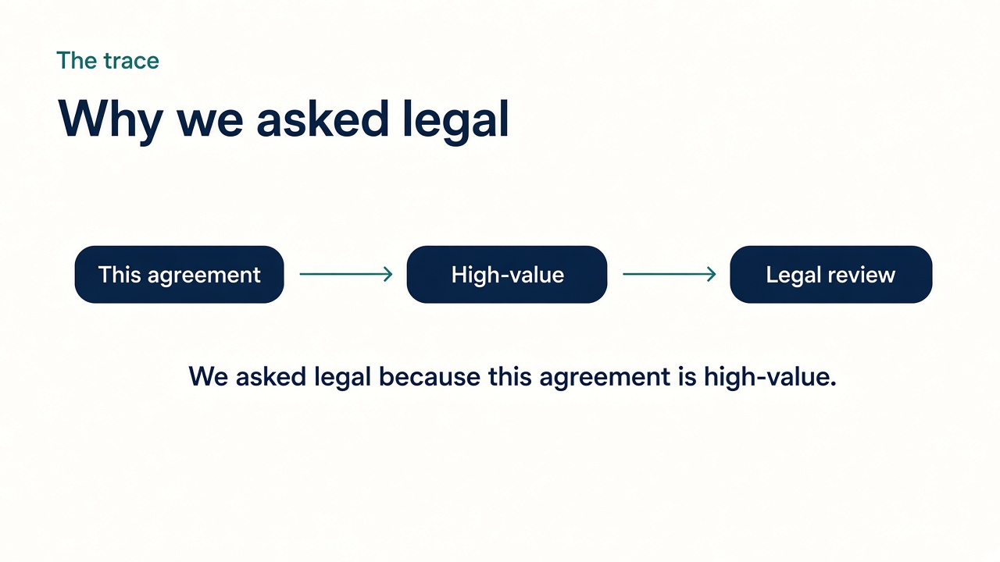

## Precise labels

These frames use the product terms. The explainer above uses the spoken words for the same ideas.

Schema, instance, and step nodes connect only to their own kind, through `POINTS_TO`. A sequence names the step the walk starts at.

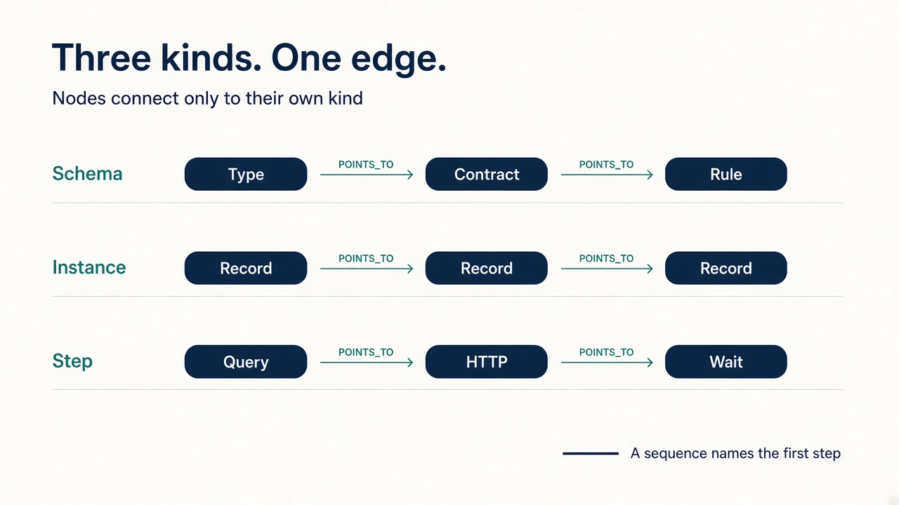

A declarative package goes through the composer, which emits Cypher for the graph and SQLite for nested data.

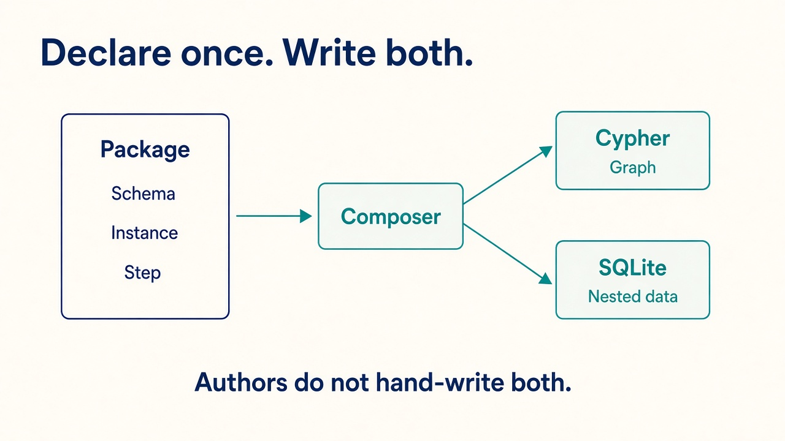

Neo4j holds links and routing. Per-space SQLite holds nested values inside an entity. Vector search answers what sounds alike, and only for opted-in properties.

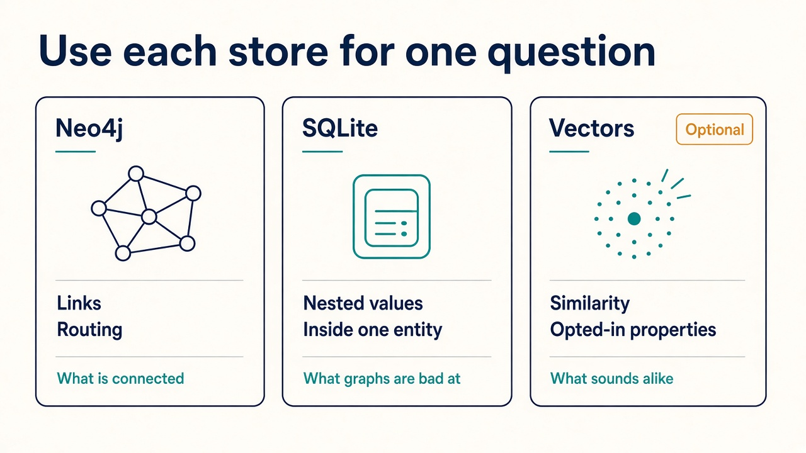
